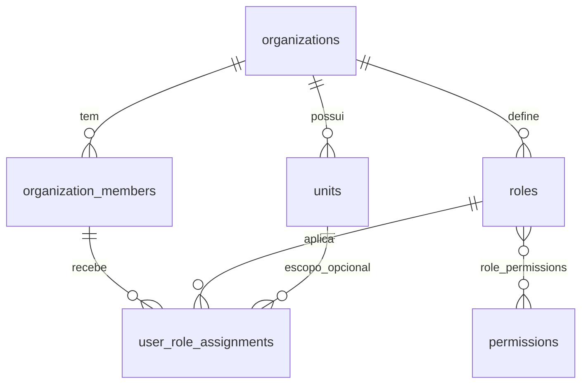
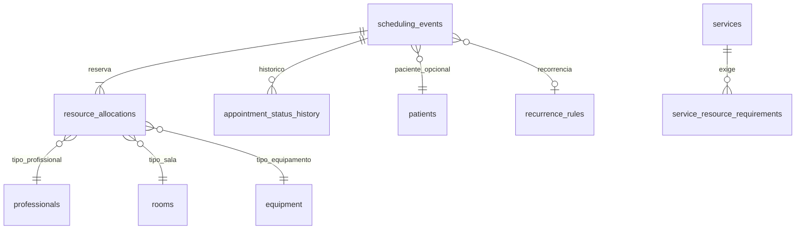
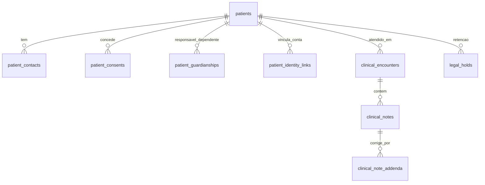
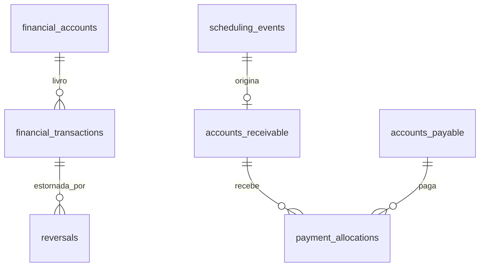

# ERD (proposta para validação; **nenhuma tabela foi criada**)

Convenções: PK `id uuid`; tabelas privadas com `organization_id uuid NOT NULL`; FKs compostas `(organization_id, x_id)`; `created_at/updated_at timestamptz`; `deleted_at` apenas onde exclusão lógica for permitida; horários sempre `timestamptz` (UTC) + fuso da unidade.

## Domínio Organização e Acesso

## Domínio Agenda (núcleo único)

`resource_allocations`: `(resource_type, resource_id, period tstzrange, status)`; `EXCLUDE USING gist (organization_id WITH =, resource_type WITH =, resource_id WITH =, period WITH &&) WHERE (status='active')`.

## Domínio Pacientes e Clínico

## Financeiro

Demais domínios (exames, atendimento/conversas, comunicação, estoque, SaaS, auditoria, infraestrutura) seguem a lista de referência da seção 20 do prompt mestre e serão modelados **na subfase correspondente**, com justificativa tabela a tabela antes de cada migration. Ajuste proposto: `patient_dependents` substituída por `patient_guardianships` (relação responsável→dependente com validade e revogação); tabelas globais (sem `organization_id`): `permissions`, `saas_plans`, `feature_flags` globais.
